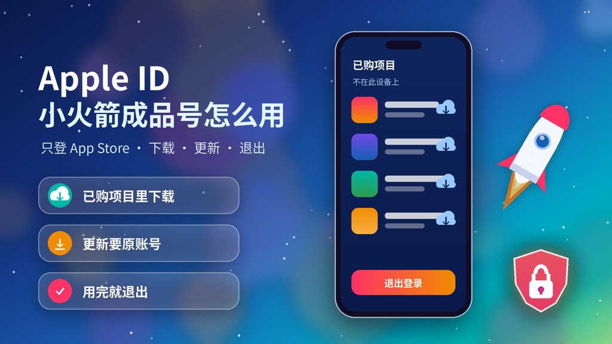
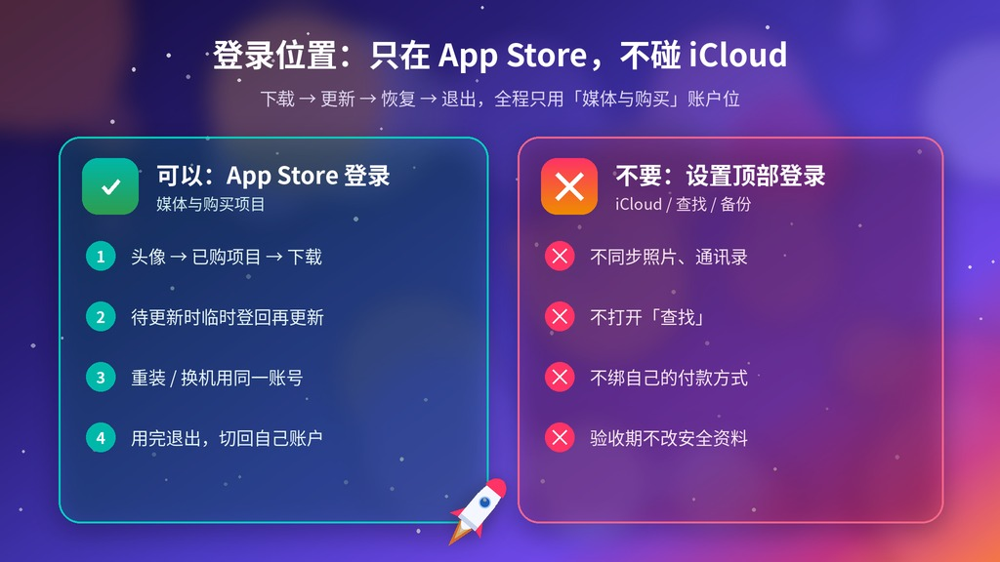
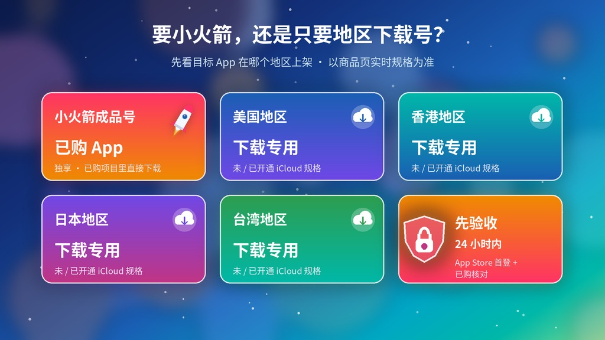

# [Apple ID小火箭成品号怎么用？Shadowrocket已购账号下载、更新与退出教程（2026）](https://hxpuzi.com/appleid-account/?utm_source=github)

买了「Apple ID · Shadowrocket成品号」，到手后怎么把小火箭下载到自己的 iPhone / iPad？以后要更新、删了要重装、用完要退出，又该怎么操作？本文是一份**到手后的操作教程**：只在 App Store（媒体与购买项目）登录 → 从「已购项目」下载 → 更新与重装 → 退出切回自己的账户 → 常见报错排查。

官网已有两篇相关文章，建议配合阅读：付款前想确认「已购、可更新」到底意味着什么，看 [小火箭 Apple ID「已购、可更新」重装前核对清单](https://hxpuzi.com/article/shadowrocket-apple-id-purchase-history-redownload-update-checklist/?utm_source=github)；想了解下载专用账号的通用登录方式，看 [Apple ID只登录App Store、不切换iCloud教程](https://hxpuzi.com/article/apple-id-app-store-only-login-guide/?utm_source=github)。本文只讲**下载、更新、恢复与退出的实际操作和排错**，不涉及 App 内的任何配置与使用。

> 价格与库存以火星小铺官网实时页面为准（本文核对日：**2026-10-23**）。密码类报错的通用排查见本站 [密码错误排查教程](../login-password-error-guide/)。

---

## 一句话结论

- **只在 App Store 登录**：交付的账号只登录 App Store 右上角头像（即「媒体与购买项目」位）。**不要在「设置」顶部登录**，那是 iCloud 主账户位，商品页明确写明从「设置」登录引发的问题不在售后范围。
- **从「已购项目」下载，不要重新付款**：头像 → App 与购买历史 / 已购项目 → 不在此设备上 → 找到小火箭 → 点云朵图标下载。
- **更新和重装都要这个账号**：App 绑定最初下载它的账号，所以交付资料要妥善保存，以后更新时临时登回来即可。
- **用完就退出**：下载 / 更新完成后在 App Store 退出，再登回自己的账户；已安装的 App 一般不会因此消失。
- **包首登只保 24 小时内首次登录**：商品页写明「登陆成功后无其他售后」，所以到手当天就把下载走一遍。

---

## 第 1 步：登录前准备（2 分钟）

1. **记下自己的账户**：打开「设置」，看顶部是你自己的 Apple 账户（iCloud），截图留底。全程**不要动这里**。
2. **确认系统版本**：小火箭对 iOS / iPadOS 版本有最低要求，系统太旧时「已购」里可能显示无法下载。
3. **保存交付资料**：卡密格式是 `账号 | 密码`。复制到你自己的密码管理器或离线备忘，不要发进群聊或共享文档。
4. **记录订单信息**：商品名、下单时间、交付时间，方便 24 小时内反馈。

---

## 第 2 步：只在 App Store 登录（不碰 iCloud）

1. 打开 **App Store** → 点右上角**头像**。
2. 如果当前登录的是你自己的购买账户：滚到页面底部点 **退出登录**（这只退出媒体购买账户，不会退出顶部 iCloud）。
3. 在同一页面用交付的 **账号 + 密码** 登录。
4. 部分账号首次登录会弹出「检查 / 条款」提示：按商品页说明 **检查 → 同意 → 下一步 → 下一步** 即可。**不要绑定自己的银行卡或付款方式**。
5. 回到「设置」确认顶部仍是**你自己的账户**——两个位置显示不同的账户是正常状态。

> 也可以在「设置 → 你的姓名 → 媒体与购买项目」里切换，这和 App Store 头像是同一个账户位；但千万不要点「设置」顶部的整机登录 / 退出。

---

## 第 3 步：从「已购项目」下载小火箭

1. App Store → 头像 → **App 与购买历史**（旧版 iOS 叫「已购项目」/「你的 App」）。
2. 切到 **不在此 iPhone 上**，搜索或找到小火箭。
3. 点右侧**云朵下载图标**；如果是「获取 / 价格」按钮而不是云朵，说明当前登录的账号里没有这条购买记录——**不要付款**，先看下文排查。
4. 下载完成后打开一次，确认能正常启动。
5. **留证**：录屏或截图「已购项目里有小火箭 → 下载完成」，遮住账号和密码。

---

## 第 4 步：以后怎么更新、重装、换设备

| 场景 | 怎么做 |
| --- | --- |
| **App 提示有更新** | App Store → 头像 → 退出自己的账户 → 登录交付账号 → 在「待更新」里点更新 → 更新完再退出、登回自己的账户 |
| **自动更新时弹出要输入别的账号密码** | 这是最初下载它的账号在请求验证。按上一行手动更新，或先取消，空闲时再操作 |
| **删掉了想重装** | 同第 3 步，从「已购项目 → 不在此设备上」重新下载 |
| **换了新 iPhone / iPad** | 新设备同样只在 App Store 登录交付账号，从已购项目下载；不要用迁移或 iCloud 备份去「带过去」账号 |
| **想同时在多台设备用** | 以商品页说明为准；频繁在多台设备切换容易触发 Apple 的验证或关联提示，建议固定少量设备 |

> 关键点：已安装的 App 一般不会因为退出账户而消失，但**更新、重装、恢复购买都需要原账号**。交付资料丢了，以后就可能无法更新。

---

## 第 5 步：用完退出，切回自己的账户

1. App Store → 头像 → 滚到底部 **退出登录**。
2. 在同一页面登录你平时用的 Apple 账户。
3. 打开「设置」再确认一次：顶部 iCloud 主账户自始至终没有变化。
4. 小火箭仍在桌面上、能正常打开，就完成了。

---

## 常见报错排查

| 提示 / 现象 | 可能原因 | 怎么办 |
| --- | --- | --- |
| 「已购项目」里找不到小火箭 | 登错了账号；购买项目被隐藏；系统版本不兼容 | 确认 App Store 头像里是交付账号；录屏「账号页 + 已购列表 + 搜索结果」，在 24 小时内联系售后，**不要自己付款覆盖** |
| 按钮显示价格 / 「获取」而不是云朵 | 当前账号没有这条购买记录 | 同上，先停手留证 |
| 「此 Apple ID 尚未在 iTunes Store 使用过」/ 需要检查条款 | 新账号首次进入商店 | 按 检查 → 同意 → 下一步 → 下一步；不绑卡 |
| 需要验证 / 账单信息有问题 | 商店要求补付款方式 | **不要绑定自己的卡**；截图后按首登售后反馈 |
| 要求输入双重认证验证码 | 交付格式只有账号和密码，验证码不在交付范围 | 停止反复尝试，截图后在 24 小时内联系售后 |
| 提示密码错误 | 复制带了空格 / 分隔符，大小写错 | 只复制 `|` 前后的字段再试；见 [密码错误排查教程](../login-password-error-guide/) |
| 「此设备已与另一个 Apple 账户关联」/ 需等待 90 天 | 短时间在同一设备频繁切换购买账户 | 停止切换，截图留证；按 Apple 官方说明等待，不要尝试绕过 |
| 「此 App 目前在你所在的国家或地区不可用」 | 账号地区与 App 上架地区不一致 | 以商品页说明为准反馈；**不要自行改区**（改区有余额、订阅等前提） |
| 更新时一直要别的账号密码 | App 绑定最初下载它的账号 | 用交付账号更新（第 4 步）；不要因此改动账号资料 |

---

## 安全边界（务必看）

- **绝不在「设置」顶部登录**交付账号：那会进入 iCloud 范围，可能涉及照片、通讯录、「查找」和备份，商品页也明确不在售后范围。
- **不打开「查找」、不同步 iCloud、不绑自己的付款方式**。
- **验收期不改安全资料**：首登和下载验收没完成前，不改密码、受信任号码或安全问题。商品页建议后续修改密码与安全信息；如你决定修改，只在 Apple 官方账户页面操作、一次只改一项、改完立即记录。**不要把这个账号分享给他人共用，也不要改动与他人共用账号的密码和安全信息。**
- **不要把账号密码交给陌生的「验号」网站或群聊**。
- **包首登**：交付后 24 小时内首次登录成功即完成售后；之后因风控 / 环境 / 操作引发的问题不在售后。所以到手当天就完成「登录 → 下载 → 打开 → 退出」整套流程。
- 本文只讲 App Store 层面的下载、更新与退出，不涉及 App 内配置，也不提供任何绕过 Apple 地区或安全限制的方法。

---

## 在售规格（核对日 2026-10-23）

先想清楚：你要的是**已经买好小火箭的账号**，还是只需要**某个地区的 App Store 下载号**。

| 规格 | 价格 | 适合 | 链接 |
| --- | --- | --- | --- |
| Apple ID · Shadowrocket成品号 · 独享账号 · 带小火箭 | **¥49.68** | 想直接从「已购项目」下载小火箭 | [立即购买](https://hxpuzi.com/buy-apple-id-shadowrocket-pre-configured-private-account-ios/?utm_source=github) |
| Apple ID · 美国地区 · App下载专用 · 独享可转区 | **¥34.56** | 下载美区上架的 App（以所选规格为准） | [立即购买](https://hxpuzi.com/buy-apple-id-usa-region-app-store-download-private/?utm_source=github) |
| Apple ID · 香港地区 · App下载专用 · 独享可转区 | **¥23.04** | 下载港区上架的 App | [立即购买](https://hxpuzi.com/buy-apple-id-hong-kong-region-app-store-download-private/?utm_source=github) |
| Apple ID · 日本地区 · App下载专用 · 独享可转区 | **¥23.04** | 下载日区上架的 App | [立即购买](https://hxpuzi.com/buy-apple-id-japan-region-app-store-download-private/?utm_source=github) |
| Apple ID · 台湾地区 · App下载专用 · 独享可转区 | **¥23.04** | 下载台区上架的 App | [立即购买](https://hxpuzi.com/buy-apple-id-taiwan-region-app-store-download-private/?utm_source=github) |

[查看分类](https://hxpuzi.com/appleid-account/?utm_source=github)

地区下载号的「未 / 已开通 iCloud」规格怎么理解，见官网 [Apple ID商品「未/已开通iCloud」怎么选](https://hxpuzi.com/article/apple-id-icloud-enabled-vs-unopened-app-store-boundary-guide/?utm_source=github)；「可转区」的前提条件见 [Apple ID可转区是什么意思](https://hxpuzi.com/article/apple-id-region-change-balance-subscriptions-family-payment-checklist/?utm_source=github)。

---

## 常见问题

**Q1：小火箭成品号要在「设置」里登录吗？**  
不要。只在 App Store 头像（媒体与购买项目）里登录。「设置」顶部是 iCloud 主账户位，商品页写明从那里登录引发的问题不在售后。

**Q2：已购项目里没有小火箭，我再买一次可以吗？**  
不要。按钮显示价格说明当前账号没有这条购买记录：先确认登录的是交付账号，再录屏留证，在 24 小时内联系售后。

**Q3：退出账号后，小火箭会不会被删掉？**  
一般不会，已安装的 App 仍可打开；但以后更新、重装要临时登回这个账号。

**Q4：小火箭提示更新，要输入别的账号密码怎么办？**  
那是最初下载它的账号。在 App Store 临时登录交付账号完成更新，再退出切回自己的账户。

**Q5：要不要改密码？**  
首登和下载验收完成前不要改。商品页建议后续改密码与安全信息；如需修改，只在 Apple 官方页面一次改一项并立即记录。不要把账号分给别人共用。

**Q6：只想下载其他地区的 App，买哪个？**  
买对应地区的下载专用号即可（美国 ¥34.56，香港 / 日本 / 台湾 ¥23.04，以所选规格为准），见 [苹果ID账号分类](https://hxpuzi.com/appleid-account/?utm_source=github)。

---

## 总结

1. **只在 App Store 登录**，「设置」顶部的 iCloud 不碰。
2. **从「已购项目 → 不在此设备上」下载**，看到价格按钮就停手留证。
3. **更新 / 重装要原账号**，交付资料保存好，用完就退出。
4. **24 小时内完成整套验收**，包首登之外不再售后。

[立即购买](https://hxpuzi.com/buy-apple-id-shadowrocket-pre-configured-private-account-ios/?utm_source=github) · [查看分类](https://hxpuzi.com/appleid-account/?utm_source=github)

---

*本文为火星小铺站外教程索引的一部分；渠道参数 `utm_source=github`。Apple、App Store、iCloud 是 Apple Inc. 的商标；本文与 Apple 无关联。*
