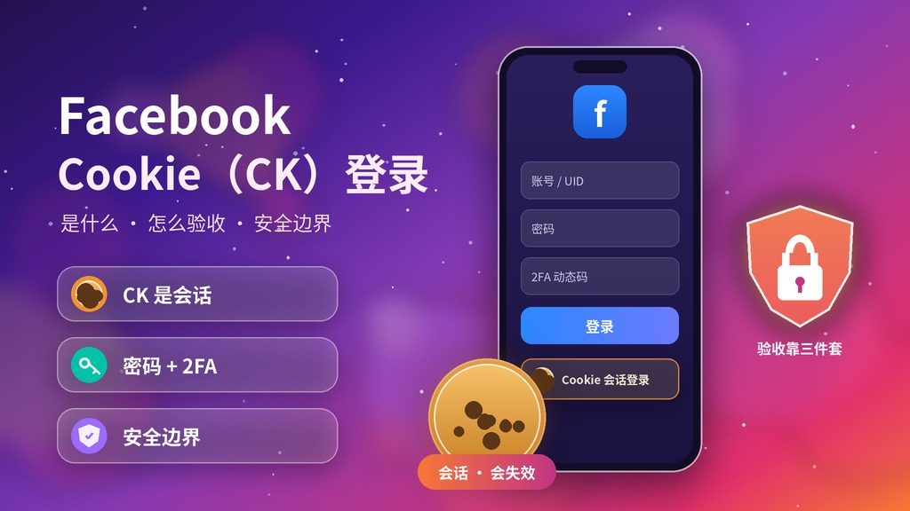
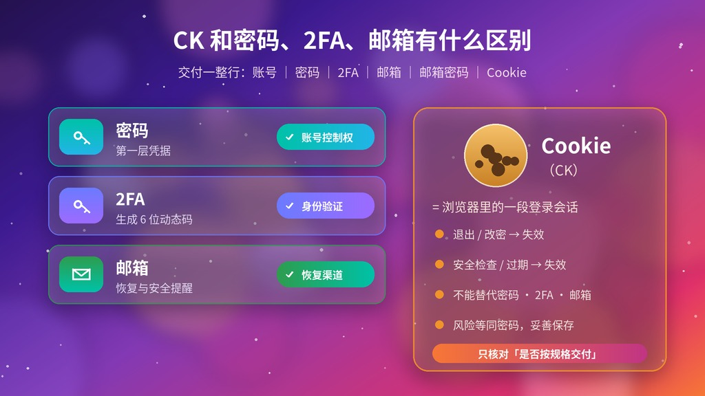
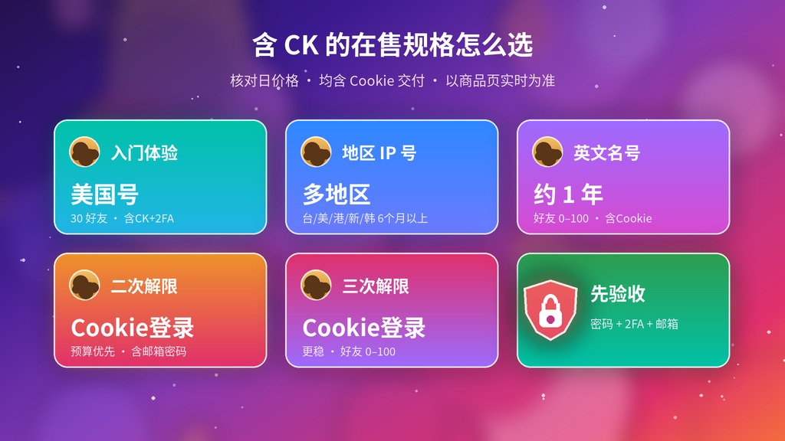

# [Facebook Cookie（CK）登录是什么？什么时候用、失败原因与安全边界（2026更新）](https://hxpuzi.com/facebook/?utm_source=github)

买 Facebook 账号时，很多规格写着「含 CK」「Cookie登录」。CK 到底是什么？拿到后一定要用它登录吗？为什么有时一用就失效？官网 8 月发过一篇 [Facebook CK登陆教程](https://hxpuzi.com/article/fb-ck-login/?utm_source=github)，讲的是插件式操作；9 月的 [Facebook交付格式与首登验收指南](https://hxpuzi.com/article/facebook-uid-2fa-email-cookie-delivery-acceptance-guide/?utm_source=github) 立场更明确：**Cookie 只是敏感的会话资料，不能替代密码、2FA 和邮箱控制权**。本文按后者的立场更新：讲清 CK 是什么、什么时候会用到、到手怎么验收、常见失败原因和安全边界。只讲到手核对与安全接管，**不提供 Cookie 注入、绕过 2FA 或规避平台检查的方法**。

> 价格与库存以火星小铺官网实时页面为准（本文核对日：**2026-10-21 HKT**）。2FA 操作见本站 [2FA密钥登录教程](../2fa-key-login-guide/)；密码报错见 [密码错误排查教程](../login-password-error-guide/)；解限号怎么选见 [二解 vs 三解教程](../facebook-reinstated-2nd-vs-3rd-guide/)。

---

## 一句话结论

- **CK = Cookie = 浏览器里的一段登录会话**。它不是密码，也不是永久凭据：退出登录、改密码、触发安全检查或过一段时间，它都可能失效。
- **验收靠「密码 + 2FA + 邮箱」**：在 Facebook 官方入口用交付的密码和 2FA 登录、单独验证邮箱能进，才算真正接管。CK 只核对「有没有按规格交付」。
- **CK 的风险等同密码**：不要粘贴到来源不明的扩展、在线转换站、共享文档或群聊。
- **含 CK 的规格在售 ¥11.52 起**：美国 30 好友号 ¥11.52，台湾 / 美国 / 香港 / 新加坡 / 韩国 IP 6 个月以上号 ¥28.80，见下文「含 CK 的在售规格」。
- **包首登只管 24 小时内首次登录**：商品页写明新环境出现停用、人脸、证件、手机号验证属平台风控，不在售后。

---

## 第 1 步：CK 是什么？和密码、2FA、邮箱有什么区别

Facebook 账号的交付通常是一整行，用 `|` 或 `：` 分隔。常见顺序（以所购商品页为准）：

- 解限号 / 英文名号：`账号 | 密码 | 2FA | 邮箱 | 邮箱密码 | 辅助邮箱 | Cookie`
- 地区 IP 6 个月以上号：`登入名称：密码：电话号码：2FA：邮箱：邮箱密码：注册IP：Cookie`（Cookie 为 JSON 格式）

| 字段 | 它是什么 | 能证明什么 | 不能证明什么 |
| --- | --- | --- | --- |
| **UID / 登入名称** | 资料页对应的数字标识 | 你拿到的是哪个账号 | 不是密码，也不代表控制权 |
| **密码** | 正常登录的第一层凭据 | 能在官方入口登录 | 不代表邮箱和 2FA 也可控 |
| **2FA 密钥** | 导入验证器后生成 6 位动态码 | 你能通过二步验证 | 密钥本身不是 6 位码 |
| **邮箱 + 邮箱密码** | 接收安全提醒与恢复信息 | 你掌握恢复渠道 | 只看到邮箱地址不等于能进收件箱 |
| **Cookie（CK）** | 浏览器保存的登录会话 | 交付时这段会话按规格给了 | 不是永久凭据，不能替代以上任何一项 |

**怎么认出 CK 字段**：通常是整行里最长的一段，多为 `[{...}]` 的 JSON，或「名称=值; 名称=值」的串。它只对应「有没有按规格交付」，不代表账号已被你完整接管。

---

## 第 2 步：什么时候会用到 CK（和什么时候不需要）

- **卖家把 CK 列为「推荐首登方式」**：部分地区 IP 号商品页写明「首次登录强烈建议使用 Cookie / 缓存登录，可有效降低账号停用风险」。这是因为换了新设备 / 新 IP 直接输账号密码，平台更敏感。
- **你已经能用密码 + 2FA 正常登录**：那就不一定要用 CK。能通过官方入口完成密码、2FA、邮箱核对，才是更完整、可解释的验收证据。
- **只想确认「有没有交付 CK」**：核对字段是否存在、格式是否完整即可，不必为了证明账号可用而把它导入不明工具。
- **CK 已失效**：这很常见（见下文失败原因）。此时回到密码 + 2FA 正常登录即可，不影响账号本身可用。

> 安全提示：本文不教 Cookie 注入 / 导入的具体操作。把 CK 当成密码级敏感数据保存即可；真要用，只在你自己可信的环境里，不要交给来源不明的扩展或网站。

---

## 第 3 步：5 分钟到手验收（按安全顺序）

1. **先留证**：记录商品名、规格、下单时间、承诺字段和售后时限。截图时遮住密码、邮箱密码、2FA 密钥和 CK。
2. **拆字段**：按商品页给的顺序把整行拆成「账号 ｜ 密码 ｜ 2FA ｜ 邮箱 ｜ 邮箱密码 ｜ Cookie」，别把邮箱密码当成 Facebook 密码。
3. **核对入口**：手动输入 facebook.com 或用官方 App，不要从陌生短链进登录页。
4. **先核对 UID**：打开交付的资料链接，确认 UID / 姓名 / 资料页一致，避免在错号上操作。
5. **正常登录**：用账号 + 密码登录；提示二步验证时，填你自己验证器里当前的 6 位码（2FA 导入见 [2FA密钥登录教程](../2fa-key-login-guide/)）。
6. **单独验证邮箱**：确认邮箱 + 邮箱密码能进收件箱、能收安全提醒。Facebook 能打开 ≠ 邮箱已验收。
7. **核对规格属性**：注册年份、国家 / 地区、好友数、Marketplace 等所购属性逐项对。
8. **最后看安全状态**：密码、邮箱、2FA 都确认可用后，再进「账号中心 → 密码和安全」看登录活动，一次只改一项。

---

## 第 4 步：CK 登录失败的常见原因

| 现象 | 可能原因 | 怎么办 |
| --- | --- | --- |
| CK 导入后仍要求输密码 | 会话已过期 / 已被服务端作废 | 直接用密码 + 2FA 正常登录，不影响账号 |
| 一登就提示「可疑登录 / 确认是你本人」 | 换了新设备或新 IP，触发风控 | 按官方流程验证；首登尽量用干净、稳定的环境 |
| 提示密码错误 | 整段复制混入空格 / 分隔符、大小写 | 按 [密码错误排查教程](../login-password-error-guide/) 排查后再联系售后 |
| 要求手机号验证 / 人脸 | 新环境平台风控 | 商品页已写明此类不在售后；用你能长期接短信的号按官方提示完成，或停止操作 |
| 短期内改不了密码 / 2FA / 邮箱 | 部分地区号说明有冷却期 | 商品页建议先养号 30–45 天，不要上来就批量改设置 |
| CK 字段看起来缺失 | 规格本就不含 / 字段顺序理解错 | 对照商品页字段说明；确实缺失再在售后时限内反馈 |

> 「上号秒死也算登录成功」是多数 FB 商品的售后口径：售后只保 24 小时内能首次登录，之后因 IP / 设备 / 环境导致的封禁需自行解决。先少量测试，合适再加购。

---

## 含 CK 的在售规格

下面都是当日 InStock、交付字段含 Cookie 的规格（核对日 2026-10-21，单个标价，以商品页实时为准）。

### 入门 / 地区号

| 规格 | 价格 | 适合 | 链接 |
| --- | --- | --- | --- |
| 美国FB · 30好友 · Outlook验证 · 含Cookie和2FA · 美国IP | **¥11.52** | 最低成本体验含 CK 的号 | [立即购买](https://hxpuzi.com/usa-facebook-30-friends-outlook-verified-avatar-cookie-2fa/?utm_source=github) |
| 【台湾IP】FB 6个月以上号 · 2FA · 邮箱 · CK | **¥28.80** | 要台湾 IP 注册 | [立即购买](https://hxpuzi.com/fb-taiwan-ip-6-months-2fa-email-cookie/?utm_source=github) |
| 【美国IP】FB 6个月以上老号 · 2FA · 邮箱 · CK | **¥28.80** | 要美国 IP 注册 | [立即购买](https://hxpuzi.com/fb-us-ip-6-months-old-2fa-email-cookie/?utm_source=github) |
| 【香港IP】FB 6个月以上号 · CK | **¥28.80** | 要香港 IP 注册 | [立即购买](https://hxpuzi.com/fb-hk-ip-6-months-2fa-email-cookie/?utm_source=github) |
| 【新加坡IP】FB 6个月以上老号 · CK | **¥28.80** | 要新加坡 IP 注册 | [立即购买](https://hxpuzi.com/fb-singapore-ip-6-months-old-2fa-email-cookie/?utm_source=github) |
| 【韩国IP】FB 6个月以上老号 · CK | **¥28.80** | 要韩国 IP 注册 | [立即购买](https://hxpuzi.com/fb-korea-ip-6-months-old-2fa-email-cookie/?utm_source=github) |

[查看分类](https://hxpuzi.com/facebook/?utm_source=github)

### 解限号 / 英文名号（含 Cookie 登录）

| 规格 | 价格 | 适合 | 链接 |
| --- | --- | --- | --- |
| FB 英文名 · 注册约1年 · 好友0–100 · 2FA · 邮箱 · 附带Cookie | **¥27.94** | 要英文名 + 1 年号龄 | [立即购买](https://hxpuzi.com/facebook-english-name-1-year-100-500-friends-2fa-email-cookie/?utm_source=github) |
| FB 二次解限 · 黑号956 · 2FA · 邮箱密码 · Cookie登录 | **¥25.20** | 二解号、预算优先 | [立即购买](https://hxpuzi.com/facebook-2nd-unlocked-956-2fa-email-cookie/?utm_source=github) |
| FB 三次解限 · Cookie登录 · 注册约1年 · 好友0–100 · 2FA · 邮箱密码 | **¥57.60** | 要更稳的三解号 | [立即购买](https://hxpuzi.com/facebook-3rd-unlocked-cookie-login-1year-0-100-friends/?utm_source=github) |

解限号怎么选、二解和三解有什么区别，见本站 [Facebook二解 vs 三解教程](../facebook-reinstated-2nd-vs-3rd-guide/)；两类号的 [二次解限号分类](https://hxpuzi.com/facebook-reinstated-account/?utm_source=github) 与 [三次解限号分类](https://hxpuzi.com/facebook-reinstated-account-3/?utm_source=github) 也可直接看。

---

## 安全边界与包首登

- **CK 是密码级敏感数据**：泄露风险接近泄露登录凭据。不要把 CK 粘贴到第三方扩展、在线转换站、共享文档或群聊。
- **验收以密码 + 2FA + 邮箱为准**：能通过官方入口完成这三项核对，比「CK 能进」更可靠。CK 只核对是否按规格交付。
- **包首登覆盖**：交付后约 24 小时内，用交付信息无法首次登录等问题（以商品页为准；多数写明「上号秒死也算登录成功」）。
- **一般不覆盖**：因 IP / 设备 / 环境登不上、新环境被要求人脸 / 证件 / 手机号验证、登录成功后被限制、你自行改密换绑后的问题，以及「长期不封」之类承诺。
- **先少量测试**：卡密不可退换，先买 1 个走通「下单 → 首登验收 → 复盘」，合适再加购。

---

## 常见问题

**Q1：CK 和密码能同时用吗？有了 CK 还要密码吗？**  
要。CK 只是会话，随时可能失效；密码 + 2FA + 邮箱才是账号控制权。验收务必确认这三项。

**Q2：卖家说首登建议用 Cookie，为什么？**  
换新设备 / 新 IP 直接输账号密码，平台更容易触发风控；用交付时的会话能减少异地登录验证。但 CK 失效后仍回到密码 + 2FA 登录。

**Q3：CK 一导入就失效 / 还是要密码，是不是号有问题？**  
多半不是。退出、改密、安全检查或时间过久都会让会话失效，属正常现象。直接用密码 + 2FA 登录即可。

**Q4：能把 CK 粘到网上的「Cookie 登录工具」吗？**  
不建议。CK 泄露风险等同密码。只在你自己可信的环境使用，不要交给来源不明的扩展或网站。本文不提供注入步骤。

**Q5：含 CK 的号最便宜多少？**  
当日 ¥11.52（美国 30 好友号）起；地区 IP 6 个月以上号 ¥28.80，以 [Facebook分类](https://hxpuzi.com/facebook/?utm_source=github) 实时页为准。

**Q6：2FA 密钥和 6 位码有什么区别？**  
密钥是一长串字符，导入验证器后持续生成 6 位码；6 位码约 30 秒失效。详见 [2FA密钥登录教程](../2fa-key-login-guide/)。

---

## 总结

1. **CK = 一段登录会话**，不是密码、不是永久凭据，会失效很正常。
2. **验收靠密码 + 2FA + 邮箱**，CK 只核对是否按规格交付。
3. **CK 风险等同密码**，不要交给不明扩展 / 网站；本文不教注入。
4. **含 CK 规格 ¥11.52 起**，以 [Facebook分类](https://hxpuzi.com/facebook/?utm_source=github) 实时页为准；相关阅读 [2FA教程](../2fa-key-login-guide/)、[密码错误排查](../login-password-error-guide/)、[二解 vs 三解](../facebook-reinstated-2nd-vs-3rd-guide/)。

[立即购买](https://hxpuzi.com/usa-facebook-30-friends-outlook-verified-avatar-cookie-2fa/?utm_source=github) · [查看分类](https://hxpuzi.com/facebook/?utm_source=github)

---

*本文为火星小铺站外教程索引的一部分；渠道参数 `utm_source=github`。*
