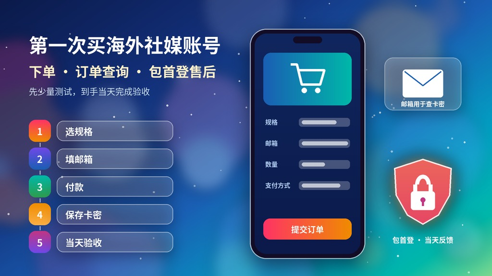
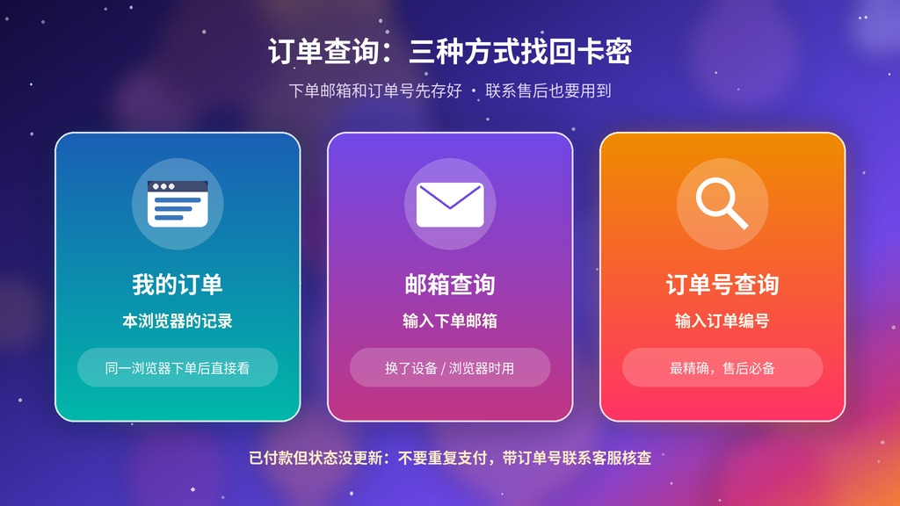
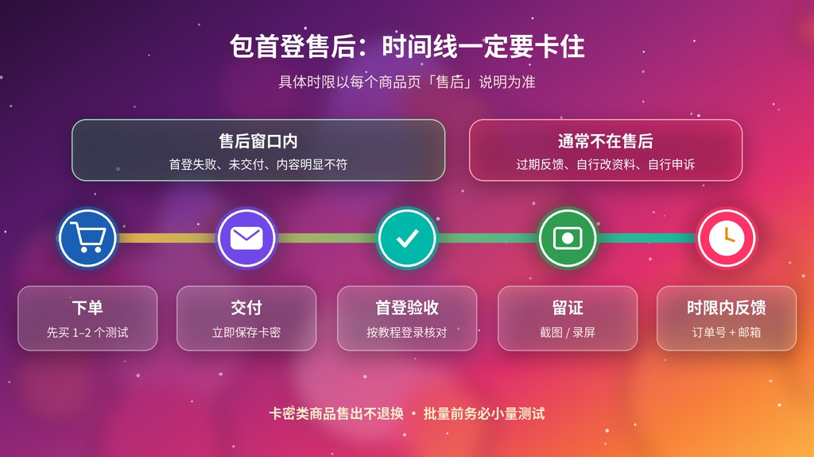

# [第一次买海外社媒账号？火星小铺下单、订单查询与“包首登”售后完整指南（2026）](https://hxpuzi.com/?utm_source=github)

第一次在火星小铺买账号，最容易出问题的往往不是登录本身，而是：**邮箱填错查不到卡密、付了款以为没到账又付一次、卡密没保存、过了包首登时限才去反馈**。本文是一份**新手下单与售后流程教程**：下单前准备 → 下单页逐项填写 → 订单查询 → 到手保存与首登验收 → 售后时限与联系客服。

所有规则都来自官网公开页面：[服务协议](https://hxpuzi.com/service/?utm_source=github)、站内「规则说明」、[订单查询](https://hxpuzi.com/orders/?utm_source=github)、[联系我们](https://hxpuzi.com/contact/?utm_source=github) 和各商品页的「关于售后」。本文只讲下单、查单、验收与售后流程，不涉及任何规避平台规则的操作。

> 价格与库存以火星小铺官网实时页面为准（本文核对日：**2026-10-26**）。各平台的登录验收细节见本仓库其他教程与 [官网使用教程](https://hxpuzi.com/articles/?utm_source=github)。

---

## 一句话结论

- **先买 1–2 个测试**：官网规则写明「所有账号建议均需先少量 1 个 2 个购买测试」，没测试就大量购买导致的批量风控一律不包售后。
- **电子邮箱要填自己能收信的**：下单页写明该邮箱「用于查询购买卡密信息」，售后也要提供下单邮箱。
- **付款后去「订单查询」**：支持「我的订单（本浏览器记录）/ 邮箱 / 订单号」三种方式。
- **到手立即保存卡密、当天首登**：卡密类商品售出不退换；包首登只保商品页写明时限内的首次登录，过期反馈无效。
- **有问题带订单号 + 下单邮箱联系客服**：目前开放电子邮箱，客服在线 9:30–23:59。

---

## 第 1 步：下单前准备（3 分钟）

1. **先看商品详情**：每个商品页都写了「账号格式」（例如 `账号 | 密码 | 邮箱 | 2FA | token`）和「关于售后」。交付格式决定你要怎么登录，售后时限决定你必须多快完成验收。
2. **先看对应教程**：官网规则写明「没有义务负责教会用户使用相关产品，购买前务必自行了解相关教程」。按平台先读一遍验收教程（见文末链接）。
3. **准备一个能收信的邮箱**：用于下单查询和售后联系。
4. **想清楚用途再选号**：官网提醒「并非价格高的号才是适合您业务的账号」；同时「小白号风控严重，稳定性会偏差，长期使用的尽量买老号」。

---

## 第 2 步：下单页逐项填写

商品页右侧的下单区（以官网当前页面为准）依次是：

| 字段 | 怎么填 | 注意 |
| --- | --- | --- |
| **商品规格** | 选数量档，例如 1个 / 30个 / 100个（Telegram 为 1个 / 3个 / 10个） | 每个规格旁会显示库存状态 |
| **电子邮箱** | 填你自己常用、能收信的邮箱 | 页面写明「用于查询购买卡密信息」，填错会很难查单 |
| **购买数量** | 第一次建议 1–2 个 | 测试没问题再加量 |
| **支付方式** | 支付宝、微信（单笔最高 ¥200.02），以及 USDT-TRC20 / USDT-ERC20 / USDT-BEP20 / ETH / TRX | 不同方式的手续费不同，以页面显示为准（核对日支付宝/微信显示 3.00%，加密货币显示 0.00%） |
| **商品小计 / 手续费 / 应付金额** | 核对一遍再点 **立即支付** | 低价商品选支付宝/微信时可能提示「订单金额低于该支付方式最低金额」 |

> 商品页标注「支付确认后发货」。服务协议还写明：提交订单不代表交易最终成立，库存不足、价格显示异常或风控拦截无法履约时，平台会取消订单并按原支付路径处理已收款项。

**要不要先注册账户？** 下单页本身就有邮箱字段；[登录 / 注册](https://hxpuzi.com/auth/?utm_source=github) 页说明「登录后可查看订单与账户余额」，支持 Google 或邮箱登录，按需选择。

---

## 第 3 步：付款后去哪里看订单和卡密

打开 [订单查询](https://hxpuzi.com/orders/?utm_source=github)，有三种方式：

1. **我的订单**：读取「本浏览器」的订单记录——在同一个浏览器下单后直接看最方便；换了设备或清过浏览器数据就可能显示「本浏览器暂无订单记录」。
2. **邮箱**：输入**下单邮箱** → 立即查询。
3. **订单号**：输入**订单编号** → 立即查询。

**已付款但状态没更新？** 服务协议原文：「如已付款但订单状态未更新，请勿重复支付，并通过订单号联系我们核查。」支付到账时间可能受支付渠道影响，先用邮箱查一次，再带订单号联系客服。

---

## 第 4 步：到手立即保存，当天完成首登验收

1. **立即保存卡密**：复制到自己的密码管理器或离线文件一份。官网规则：「下单请立即保存自己账户信息」，后续卡密丢失无法帮助找回。
2. **按交付格式逐项登录**：只复制分隔符 `|` 之间的字段，注意大小写和多余空格。
3. **登录提示密码错误先自查**：官网规则写明「请先自行尝试切换 IP / 设备 / 清除缓存重新登录，大部分都是 IP 环境的问题」。详见本仓库 [密码错误排查教程](../login-password-error-guide/)。
4. **留证**：录屏或截图「登录过程 + 报错提示 + 时间」，遮住密码。
5. **核验前不改关键资料**：服务协议要求完成核验前勿擅自修改关键资料、转售、共享。核验通过后再按各平台教程做安全接管。
6. **个人号权限受限不要自行申诉**：官网规则写明「申诉无售后」。

**不同平台的首登要点（来自商品页）**

| 商品 | 交付格式 | 商品页写明的售后 |
| --- | --- | --- |
| Instagram新账号 | 用户名 \| 密码 \| 2FA密钥 | 登录质保在交付时生效；成功登录后所做的更改不在质保范围 |
| Threads新账号 | 用户名 \| 密码 \| 2FA密钥 | 交付登录质保 + 12 小时换货质保；修改凭证/安全设置后不在质保 |
| 推特 Token 号、Discord 满月号 | 账号 \| 密码 \| 邮箱 \| 2FA \| Token（以规格为准） | 24 小时内包首次登录成功，登录成功后无其他售后 |
| Telegram 成品号 | 电话号码 \| API接码链接 | 24 小时内首登；「账号冻结」不在售后；除 API 链接显示「账号死亡」外无售后；API 链接会过期；登录后至少保持一个设备在线，不提供二次接码 |

> Telegram 注册未满 3 天有保护期（无法与非好友对话），满 3 天自行解除，详见官网 [Telegram 3天保护期核对教程](https://hxpuzi.com/article/telegram-account-three-day-protection-period-guide/?utm_source=github)。

---

## 第 5 步：售后时限与联系客服

**哪些情况可以申请售后（服务协议第六条）**：未交付、重复扣款、交付内容与订单明显不符，或商品在交付时因平台原因无法使用——平台会根据实际情况补发、更换、修复或退款，退款尽量原路退回。

**哪些情况一般不在售后**：

- 卡密类商品售出后「概不提供任何理由的退换货服务」（官网同时承诺不对卡密二次销售）。
- 包首登「为包当天首登，过期反馈无效」；多数商品写明登录成功后无其他售后。
- 因填错信息、未阅读商品限制、擅自修改或共享资料、违规使用、设备或网络环境不兼容，或第三方平台交付后调整规则产生的问题，平台会协助核查，但可能无法取消或退款。
- 没测试就大量购买导致的批量风控。

**联系客服前准备**（[联系我们](https://hxpuzi.com/contact/?utm_source=github)）：

- [ ] 订单号
- [ ] 下单邮箱
- [ ] 问题截图 / 录屏（含时间）
- [ ] 一句话说明：哪一步、什么提示

目前开放的是**电子邮箱**（页面上 Telegram、WhatsApp 显示「暂未开放」），客服在线时间 **9:30–23:59**。隐私政策提醒：**不要在客服消息里发送密码、支付密码、银行卡验证码**等敏感信息。

---

## 新手测试款（核对日 2026-10-26）

第一次下单建议从低价款开始，熟悉「下单 → 查单 → 首登 → 售后」整套流程：

| 商品 | 价格 | 交付格式 | 链接 |
| --- | --- | --- | --- |
| Instagram新账号 · 含2FA密钥 · 已添加头像 | **¥1.80** | 用户名\|密码\|2FA密钥 | [立即购买](https://hxpuzi.com/instagram-new-login-2fa-key-profile-pictures/?utm_source=github) |
| Threads新账号 · 2FA密钥已启用 · 支持全球登录 | **¥1.80** | 用户名\|密码\|2FA密钥 | [立即购买](https://hxpuzi.com/threads-new-2fa-key-global-login/?utm_source=github) |
| 推特账号 · 2020–2025年注册 · 启用2FA · 包含Token | **¥5.76** | 账号\|密码\|邮箱\|2FA\|token | [立即购买](https://hxpuzi.com/buy-twitter-accounts-token/?utm_source=github) |
| Discord账号 · 满月号 · 邮箱 · 2FA · Token | **¥7.20** | 账号\|密码\|2FA\|邮箱\|Token | [立即购买](https://hxpuzi.com/buy-discord-account-one-month-old-email-two-fa-token-avatar/?utm_source=github) |
| Telegram账号 · +1美国 · 全新成品号 · API接码登录 | **¥18.72** | 电话号码\|API接码链接 | [立即购买](https://hxpuzi.com/buy-telegram-account-usa-phone-new-api/?utm_source=github) |
| Telegram账号 · +1美国 · 满月成品号 · API接码登录 | **¥20.88** | 电话号码\|API接码链接 | [立即购买](https://hxpuzi.com/buy-telegram-account-usa-aged-api/?utm_source=github) |

[查看分类](https://hxpuzi.com/?utm_source=github) · [Telegram账号分类](https://hxpuzi.com/telegram-account/?utm_source=github)

---

## 常见问题

**Q1：付了款页面没变化，要不要再付一次？**  
不要。服务协议写明请勿重复支付，用订单号联系核查；可先在订单查询用下单邮箱查一次。

**Q2：换了手机/浏览器，「我的订单」是空的？**  
「我的订单」读取的是本浏览器的记录。换设备时用**下单邮箱**或**订单号**查询；登录账户后也可查看订单。

**Q3：¥1.80 的商品为什么选不了支付宝/微信？**  
金额较低时，支付宝/微信会提示「订单金额低于该支付方式最低金额」。可选页面上的其他支付方式，或调整数量，以页面提示为准。

**Q4：「包首登」是不是包以后不封号？**  
不是。包首登只保交付后商品页写明时限内首次登录成功（多数为 24 小时内 / 当天）；登录成功后的风控、卡密丢失等一般不在售后。

**Q5：买多少个合适？**  
第一次 1–2 个。官网规则写明没测试就大量购买导致的批量风控不包售后。

**Q6：客服怎么联系？**  
[联系我们](https://hxpuzi.com/contact/?utm_source=github) 页的电子邮箱，在线 9:30–23:59；带上订单号、下单邮箱和截图。

---

## 按平台继续看验收教程

- 官网：[Telegram API接码登录、2FA与设备核对](https://hxpuzi.com/article/telegram-api-code-login-2fa-device-check-guide/?utm_source=github) · [X/Twitter邮箱、2FA、Token首登验收](https://hxpuzi.com/article/x-twitter-email-2fa-token-first-login-acceptance-guide/?utm_source=github) · [Instagram新号交付验收清单](https://hxpuzi.com/article/instagram-new-account-delivery-email-2fa-cookies-profile-checklist/?utm_source=github) · [Discord邮箱、2FA与Token验收清单](https://hxpuzi.com/article/discord-account-email-2fa-token-risk-checklist/?utm_source=github)
- 本仓库：[2FA密钥登录教程](../2fa-key-login-guide/) · [密码错误排查](../login-password-error-guide/) · [Discord Token登录](../discord-token-login-guide/) · [Instagram新号第一周](../instagram-new-account-first-week-guide/)

---

## 总结

1. **先读商品详情与售后**，第一次只买 1–2 个。
2. **邮箱填对**，付款后在订单查询用「我的订单 / 邮箱 / 订单号」找卡密；没更新不要重复付。
3. **立即保存卡密、当天首登并留证**，核验前不改关键资料。
4. **时限内带订单号 + 下单邮箱联系客服**，不发密码。

[立即购买](https://hxpuzi.com/buy-twitter-accounts-token/?utm_source=github) · [查看分类](https://hxpuzi.com/?utm_source=github)

---

*本文为火星小铺站外教程索引的一部分；渠道参数 `utm_source=github`。所列平台名称均为各自权利人的商标；本文与各平台无关联。*
