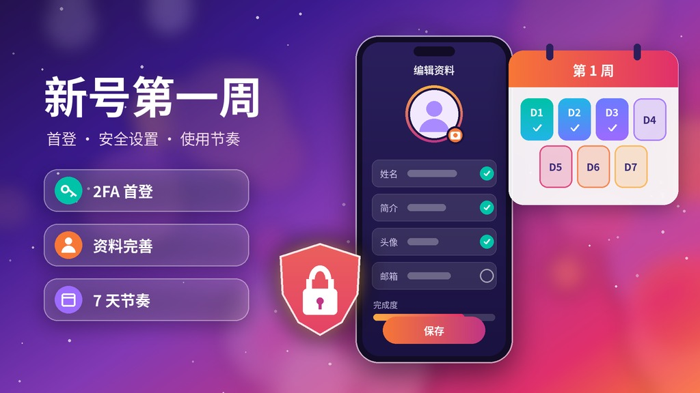
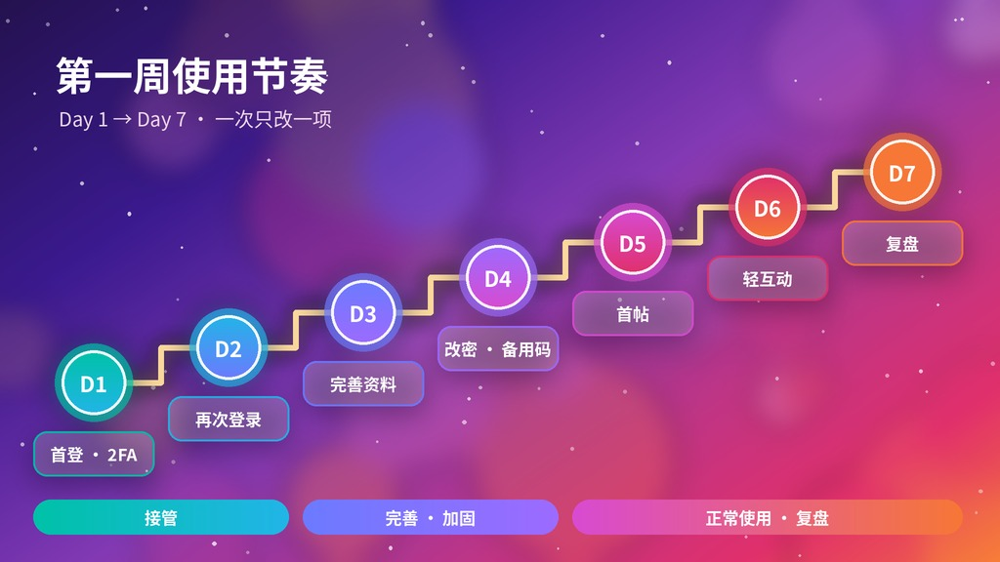
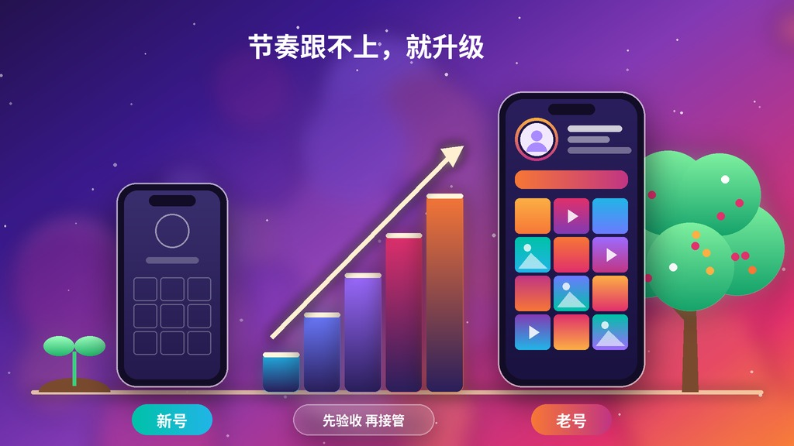

# [Instagram新号到手第一周怎么用？2FA新号首登、资料完善与使用节奏（2026）](https://hxpuzi.com/instagram-new/?utm_source=github)

¥1.80 起的 Instagram 新号是很多人的入门款，但新号最容易出问题的时间恰恰是**到手后的头 7 天**：首登环境不稳、一上来就改密码改资料、首周就大量关注私信……官网已有 [Instagram新号交付验收清单](https://hxpuzi.com/article/instagram-new-account-delivery-email-2fa-cookies-profile-checklist/?utm_source=github)（核对邮箱、2FA、Cookies 与头像字段）；本文不重复那份清单，只讲**验收之后第一周怎么用**：2FA 首登、安全设置的先后顺序、资料完善与使用节奏、常见报错排查，以及什么时候该换成老号。只讲到手验收与安全接管，不涉及任何绕过平台限制的内容。

> 价格与库存以火星小铺官网实时页面为准（本文核对日：**2026-10-19 HKT**）。交付字段核对见 [新号交付验收清单](https://hxpuzi.com/article/instagram-new-account-delivery-email-2fa-cookies-profile-checklist/?utm_source=github)；基础登录见 [Instagram登录教程](https://hxpuzi.com/article/ig-tutorial/?utm_source=github)；老号验收见 [Instagram老号注册年份与粉丝验收清单](https://hxpuzi.com/article/instagram-aged-account-year-followers-posts-2fa-checklist/?utm_source=github)。

---

## 一句话结论

- **新号约 ¥1.80～¥5.76**：含 2FA 密钥的新号 ¥1.80 / ¥2.88，实机注册小白号 ¥3.60 起，含 Gmail 邮箱 + Cookies 的美国 IP 新号 ¥5.76。适合**先试水、先跑通流程**。
- **第一天只做三件事**：包首登窗口内首登、把 2FA 密钥导入你自己的验证器、截图留证。**不要当天改密码**——商品页明确提示「新设备立即修改密码有封禁风险」。
- **安全设置分批做**：同一设备同一网络稳定登录 2–3 次后，再改密码、保存备用码、处理邮箱，一次只改一项。
- **首周按正常新用户的节奏用**：先完善资料、少量发原创内容，不批量关注 / 私信，不用第三方自动化工具。
- **业务要私信、关注、发帖更频繁，或新号反复弹验证** → 考虑 ¥14.40 起的老号，见下文「什么时候换老号」。

---

## 第 1 步：用 2FA 密钥完成首登（5 分钟）

新号交付格式通常是 `用户名 | 密码 | 2FA密钥`（部分规格另含邮箱或 Cookies，以所购商品页为准）。

1. **准备环境**：固定一台设备 + 一个稳定的网络，首周尽量不换。商品页说明：账号、密码、2FA 都正确但因网络环境登不上的不做售后；登录后页面报错 / 无响应多是公用网络节点导致。
2. **导入密钥**：把 2FA 密钥（一长串字母数字，不是 6 位码）添加到你自己的验证器 App，确认它在生成每 30 秒变化的 6 位码。操作细节见本站 [2FA密钥登录教程](../2fa-key-login-guide/)。
3. **官方入口登录**：只用 Instagram 官方 App 或 instagram.com，输入用户名 + 密码，提示二步验证时填验证器里**当前**的 6 位码。
4. **登录后先别动设置**：浏览几分钟首页和个人主页，确认头像、贴文、粉丝等与商品页一致（逐项核对跟官网 [交付验收清单](https://hxpuzi.com/article/instagram-new-account-delivery-email-2fa-cookies-profile-checklist/?utm_source=github)）。
5. **截图留证**：订单号、交付原文（打码）、登录成功页面与时间。首登失败时也要截下完整报错。

提示密码错误时，先排复制多余空格、大小写和网络环境，见本站 [密码错误排查教程](../login-password-error-guide/)。

---

## 第 2 步：第一周使用节奏（Day 1 → Day 7）

| 时间 | 做什么 | 先不要做 |
| --- | --- | --- |
| **Day 1（交付当天）** | 包首登窗口内首登；导入 2FA 密钥；核对交付字段；截图留证 | 改密码、改用户名、换邮箱、批量关注 |
| **Day 2–3** | 同一设备同一网络再登录；完善姓名、简介、头像（已有头像可保留）；在「账户中心 → 密码和安全」查看登录活动 | 频繁切换设备、网络或在多个工具里同时登录 |
| **Day 3–4** | 登录稳定后再**改密码**；保存备用码；商品含邮箱时先确认邮箱能收信，再按官方流程换成你自己的邮箱 | 同一天把密码、邮箱、用户名、头像全改完 |
| **Day 5–7** | 发 1–3 条原创内容；少量关注同领域账号、正常回复互动 | 首周大量关注 / 私信 / 发外链；使用第三方自动化工具 |
| **Day 7 复盘** | 登录是否稳定、有无安全提示；决定继续用新号还是换老号 | 没测试就批量下单 |

**为什么要分批？** 每次只改一项，出问题时才能定位原因；平台对新账号的大量或异常操作也更敏感，按正常节奏用最省心。这些建议只关乎接管顺序和正常使用，不能替代平台条款。

---

## 第 3 步：第一周安全清单

- [ ] 2FA 密钥已导入**你自己的**验证器，且能生成当前 6 位码
- [ ] 备用码已保存到离线位置（设置 → 账户中心 → 密码和安全 → 双重验证）
- [ ] 登录稳定 2–3 次后才改密码，新密码只存在你的密码管理器里
- [ ] 商品含邮箱：已确认能登录收信；需要时按官方流程换成你自己的邮箱
- [ ] 已查看登录活动，退出不认识的设备会话
- [ ] 姓名、简介、头像已完善，用户名确实需要时最后再改
- [ ] 交付原文、密钥、Cookies 不发群聊、不贴到不明网站

---

## 常见问题排查

| 现象 | 先检查 | 下一步 |
| --- | --- | --- |
| 2FA 验证码提示错误 | 手机时间是否自动同步；密钥有无多余空格；是否用了已过期的码 | 按 [2FA密钥登录教程](../2fa-key-login-guide/) 重新导入 |
| 提示密码错误 | 是否整段复制了分隔符或空格；大小写 | 按 [密码错误排查教程](../login-password-error-guide/) 排查后再联系售后 |
| 登录后页面空白 / 无响应 | 网络是否为公用节点；App 缓存 | 换稳定网络、清缓存后用官方 App 重试，别在同一环境反复尝试 |
| 要求手机号验证 | 商品页已说明此类情况无法售后 | 用你自己能长期接收短信的号码按官方提示完成，或停止操作 |
| 提示「确认是你本人」/ 可疑登录 | 是不是刚换了设备或网络 | 选择是本人并按官方流程验证；首周少换环境 |
| 账号被停用 | 是否仍在包首登窗口内、是否属首登问题 | 窗口内带证据联系售后；否则只走 Instagram 官方申诉入口 |

---

## 什么时候换老号

新号便宜、适合练手，但注册时间短、几乎没有历史内容。出现下面情况时，考虑换老号：

1. **业务需要更频繁地私信、关注、发帖**，新号节奏跟不上；
2. **需要老贴文、粉丝或注册年份**做基础展示；
3. **同一环境下新号反复弹验证**，不适合你的使用方式；
4. **要固定地区**：见官网 [地区号首登核验指南](https://hxpuzi.com/article/instagram-region-account-first-login-verification-guide/?utm_source=github)。

老号也不等于「不会被限制」，到手同样先验收再接管，见 [Instagram老号验收清单](https://hxpuzi.com/article/instagram-aged-account-year-followers-posts-2fa-checklist/?utm_source=github)。

### 新号（入门）

| 规格 | 价格（核对日） | 适合 | 链接 |
| --- | --- | --- | --- |
| Instagram新账号（含2FA密钥·已加头像） | **¥1.80** | 最低成本跑通首登流程 | [立即购买](https://hxpuzi.com/instagram-new-login-2fa-key-profile-pictures/?utm_source=github) |
| Instagram新账号（含2FA密钥·安卓手工注册·含备用码） | **¥2.88** | 要备用码、手机号已验证 | [立即购买](https://hxpuzi.com/new-instagram-accounts-with-2fa-key/?utm_source=github) |
| 纯净小白号（实机注册·随机贴文/粉丝） | **¥3.60 起** | 想要一点内容基础；「包24小时售后1次」规格 ¥5.04 | [立即购买](https://hxpuzi.com/buy-ig-new-account-random-followers-posts/?utm_source=github) |
| IG新号（Gmail已验证·含邮箱·2FA·Cookies·美国IP注册） | **¥5.76** | 需要邮箱可控的新号 | [立即购买](https://hxpuzi.com/ig-gmail-verified-email-2fa-cookies-avatar-usa-ip/?utm_source=github) |

[查看分类](https://hxpuzi.com/instagram-new/?utm_source=github)

### 老号（升级）

| 规格 | 价格（核对日） | 适合 | 链接 |
| --- | --- | --- | --- |
| 老号 2025年注册（2FA·随机贴文/粉丝） | **¥14.40** | 新号升级的第一档 | [立即购买](https://hxpuzi.com/buy-2fa-aged-ig-accounts-2025/?utm_source=github) |
| IG老号 2015–2019年注册（超级老号·2FA） | **¥18.72** | 要注册年份 | [立即购买](https://hxpuzi.com/instagram-2014-2019-random-region-2fa/?utm_source=github) |
| IG老号 2015–2019 耐用真人号（10–100粉·真实老贴文） | **¥32.40** | 私信、关注、发帖更频繁 | [立即购买](https://hxpuzi.com/ig-aged-2015-2019-durable-real-10-100-followers-real-posts-dm-post/?utm_source=github) |

另有 [老白号 注册1–3年 ¥20.09](https://hxpuzi.com/buy-aged-ig-blank-account-one-to-three-years-two-factor-authentication/?utm_source=github) 等规格，[查看分类](https://hxpuzi.com/instagram-age/?utm_source=github)。

---

## 包首登售后边界

- **覆盖**：交付后当日 / 约 24 小时内，用交付的账号、密码、2FA 无法完成首登等问题（以所购商品页为准）。小白号的「1个（秒死无售后）」¥3.60 与「1个（包24小时售后1次）」¥5.04 是两种规格，下单前看清。
- **一般不覆盖**：因网络环境登不上、登录弹手机验证、登录成功后被限制、你自行改密换绑之后的问题，以及「长期不封」之类承诺。
- **申请时带上**：订单号、交付原文（打码）、连续录屏或报错截图、发生时间。
- **先少量测试**：商品页建议先买少量，适合自己的业务再加购。

---

## 常见问题

**Q1：新号到手能马上改密码吗？**  
不建议。商品页提示新设备立即改密有封禁风险。先在同一设备同一网络稳定登录 2–3 次，再改密码，一次只改一项。

**Q2：2FA 密钥和 6 位验证码有什么区别？**  
密钥是一长串字符，导入验证器后持续生成 6 位码；6 位码约 30 秒失效。详见本站 [2FA密钥登录教程](../2fa-key-login-guide/)。

**Q3：第一周能发帖吗？**  
可以，按正常新用户节奏：先完善资料，再发 1–3 条原创内容；首周不批量关注、私信或发外链。

**Q4：新号能直接开通 Threads 吗？**  
Threads 依附 Instagram 账号，建议等 IG 登录稳定后再开，步骤见本站 [Threads账号登录教程](../threads-account-login-guide/)。

**Q5：¥1.80 和 ¥5.76 的新号差在哪？**  
¥1.80 交付用户名、密码、2FA 密钥；¥5.76 另含已验证 Gmail 邮箱和 Cookies，邮箱可控更方便后续接管。按是否需要邮箱选。

**Q6：一次买多少合适？**  
先买 1 个走通「下单 → 首登 → 第一周 → 复盘」，适合再加购。批量前以官网商品页说明为准。

---

## 总结

1. **Day 1 只首登 + 导入 2FA + 留证**，不当天改密。
2. **安全设置分批做**：稳定登录后改密码、存备用码、处理邮箱，一次一项。
3. **首周按正常节奏用**，不批量操作、不用自动化工具。
4. **节奏跟不上就升级**：新号 ¥1.80 起，老号 ¥14.40 起，以 [Instagram新号分类](https://hxpuzi.com/instagram-new/?utm_source=github) 实时页为准。本站还有 [2FA教程](../2fa-key-login-guide/)、[密码错误排查](../login-password-error-guide/) 与 [Threads登录教程](../threads-account-login-guide/)。

[立即购买](https://hxpuzi.com/instagram-new-login-2fa-key-profile-pictures/?utm_source=github) · [查看分类](https://hxpuzi.com/instagram-new/?utm_source=github)

---

*本文为火星小铺站外教程索引的一部分；渠道参数 `utm_source=github`。*
