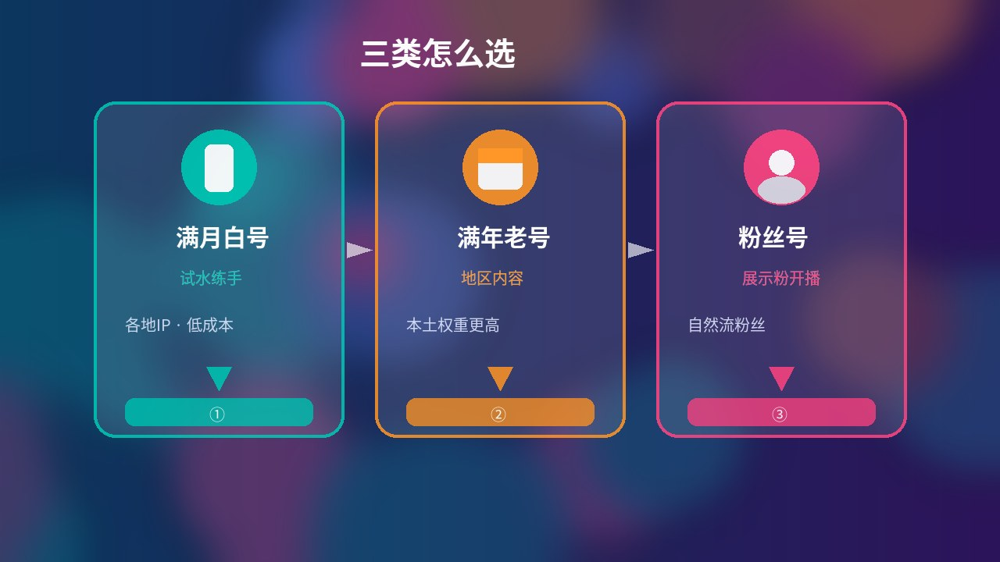
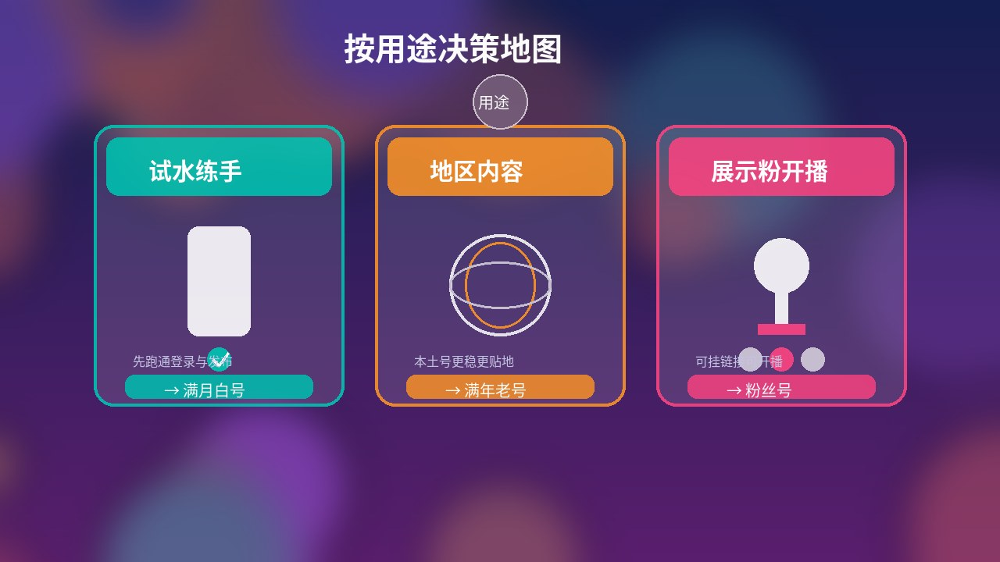

# [TikTok新号、满年老号和粉丝号怎么选？按用途对比价格与稳定性（2026）](https://hxpuzi.com/tiktok/?utm_source=github)

买 TikTok 账号时，很多人先纠结「要不要买粉」，却忽略**用途**、**号龄**和**地区是否对口**。官网已有满月白号核对、德国满年换绑、粉丝号验收、首登安全与商务管理平台账户验收等专文；本文不重复那些核对清单，只做**选购决策**：满月白号（新号线）vs 满年老号 vs 粉丝号，按试水练手、地区内容、展示粉开播怎么选，以及各地区怎么比价。只讲到手验收与安全接管，不涉及任何绕过平台限制的内容。

> 价格与库存以火星小铺官网实时页面为准（本文核对日：**2026-10-16 HKT**）。满月白号核对见 [满月白号注册/IP/号龄清单](https://hxpuzi.com/article/tiktok-full-month-blank-account-registration-ip-age-microsoft-email-checklist/?utm_source=github)；满年换绑与地区见 [德国满年老号换绑清单](https://hxpuzi.com/article/tiktok-germany-aged-account-region-content-rebind-checklist/?utm_source=github)；粉丝号验收见 [粉丝号验收指南](https://hxpuzi.com/article/tiktok-follower-account-acceptance-guide/?utm_source=github)；首登见 [TikTok首登安全指南](https://hxpuzi.com/article/tiktok-first-login-security-guide/?utm_source=github)。

---

## 一句话结论

- **满月白号约 ¥7.20**：各地 IP（台湾 / 越南 / 泰国 / 马来 / 韩国 / 德国 / 法国等）与美国女号同价带；适合**试水练手**、先跑通登录与发布。
- **满年老号约 ¥14.40 起**：台湾 / 德国 / 马来 / 新加坡本土满年约 ¥14.40；美国本土 21–22 年高权重约 **¥25.20**。更适合要**地区内容**与更高号龄权重时选。
- **粉丝号约 ¥108.00**：当前在售美国 IP 自然流 1000–4000 粉、可挂链接可开播；适合**展示粉 / 开播**场景，别当「便宜练手号」买。
- **先定用途，再定类型，最后定地区**：用途错了，再便宜也会买错线。
- **先买 1 个走通流程**：包首登窗口内完成登录与验收，再决定是否换线或加购。

---

## 三类怎么选：满月白号 vs 满年老号 vs 粉丝号

| 类型 | 核对日单价（约） | 适合谁 | 稳定性直觉 | 什么时候优先选 |
| --- | --- | --- | --- | --- |
| [满月白号 / 新号线](https://hxpuzi.com/tiktok-new-account/?utm_source=github) | **¥7.20** | 试水、练登录与发布 | 号龄较短，成本最低 | 还没定内容方向，只想先跑通流程 |
| [满年老号](https://hxpuzi.com/tiktok-aged-account/?utm_source=github) | **¥14.40～¥25.20** | 地区内容、要更高号龄 | 本土满年通常更贴地 | 已定目标地区，需要更稳的号龄基础 |
| [粉丝号](https://hxpuzi.com/tiktok-follower-account/?utm_source=github) | **¥108.00** | 展示粉、挂链接、开播 | 粉丝与作品已有基础 | 明确要「看起来有粉」或马上开播 |

**三句话记住分工**

1. **练手别一上来买粉丝号**：¥7.20 满月线足够验证交付与首登。
2. **做地区内容优先满年本土号**：同地区满年比满月贵一档，但号龄与本土属性更对齐。
3. **粉是展示层，不是验收替代**：粉丝真假与可开播字段，跟官网 [粉丝号验收指南](https://hxpuzi.com/article/tiktok-follower-account-acceptance-guide/?utm_source=github) 核对，本文不重复清单。

分类入口：[TikTok分类](https://hxpuzi.com/tiktok/?utm_source=github) · [TikTok新号](https://hxpuzi.com/tiktok-new-account/?utm_source=github) · [TikTok老号](https://hxpuzi.com/tiktok-aged-account/?utm_source=github) · [TikTok粉丝号](https://hxpuzi.com/tiktok-follower-account/?utm_source=github)

[立即购买](https://hxpuzi.com/tiktok-taiwan-ip-mature-white-email-verified/?utm_source=github) · [查看分类](https://hxpuzi.com/tiktok/?utm_source=github)

---

## 按用途决策：试水 / 地区内容 / 展示粉开播

| 你的用途 | 优先类型 | 起步规格（核对日） | 下一步 |
| --- | --- | --- | --- |
| **试水练手** | 满月白号 | 台湾 / 德国等地 IP 满月 **¥7.20**；或美国女号 **¥7.20** | 首登通过后再考虑满年或粉丝号 |
| **地区内容** | 满年老号 | 台湾 / 德国 / 马来 / 新加坡满年 **¥14.40**；要美国高权重看 **¥25.20** | 换绑改密跟官网满年专文，勿跳过 |
| **展示粉 / 开播** | 粉丝号 | 美国 IP 自然流 1000–4000 粉 **¥108.00** | 按粉丝号验收指南核对粉、作品与开播能力 |

**决策顺序（建议照做）**

1. 写出主要用途：只练手 / 固定地区发内容 / 要粉与开播。
2. 用途 → 类型：练手→满月；地区内容→满年；展示粉开播→粉丝号。
3. 再选地区：内容语言与目标市场对齐（见下一节）。
4. 仍不确定 → 先买 **1 个满月白号** 走通「下单 → 首登 → 接管」，再加购。

---

## 地区怎么选（满月与满年）

### 满月白号 / 新号线（各地 IP · ¥7.20）

| 规格 | 价格 | 链接 |
| --- | --- | --- |
| 台湾 IP 满月白号 | **¥7.20** | [立即购买](https://hxpuzi.com/tiktok-taiwan-ip-mature-white-email-verified/?utm_source=github) |
| 越南 IP 满月白号 | **¥7.20** | [立即购买](https://hxpuzi.com/tiktok-vietnam-ip-mature-white-email-verified/?utm_source=github) |
| 泰国 IP 满月白号 | **¥7.20** | [立即购买](https://hxpuzi.com/tiktok-thailand-ip-mature-white-email-verified/?utm_source=github) |
| 马来西亚 IP 满月白号 | **¥7.20** | [立即购买](https://hxpuzi.com/tiktok-malaysia-ip-mature-white-email-verified/?utm_source=github) |
| 韩国 IP 满月白号 | **¥7.20** | [立即购买](https://hxpuzi.com/tiktok-korea-ip-mature-white-email-verified/?utm_source=github) |
| 德国 IP 满月白号 | **¥7.20** | [立即购买](https://hxpuzi.com/tiktok-germany-ip-mature-white-email-verified/?utm_source=github) |
| 法国 IP 满月白号 | **¥7.20** | [立即购买](https://hxpuzi.com/tiktok-france-ip-mature-white-email-verified/?utm_source=github) |
| 美国女号（邮箱已验证·带头像） | **¥7.20** | [立即购买](https://hxpuzi.com/usa-tiktok-female-email-verified-avatar-us-ip/?utm_source=github) |

同价带下，**按内容目标市场选 IP**，不要只看国旗好看。核对字段见 [满月白号清单](https://hxpuzi.com/article/tiktok-full-month-blank-account-registration-ip-age-microsoft-email-checklist/?utm_source=github)。

### 满年老号（本土 · ¥14.40 起）

| 规格 | 价格 | 备注 | 链接 |
| --- | --- | --- | --- |
| 台湾本土满年 | **¥14.40** | 任何设备登录 | [立即购买](https://hxpuzi.com/tiktok-taiwan-native-year-aged-white-any-device/?utm_source=github) |
| 德国本土满年 | **¥14.40** | 可换绑可改密 | [立即购买](https://hxpuzi.com/tiktok-germany-native-year-aged-white-any-device-rebind/?utm_source=github) |
| 马来西亚本土满年 | **¥14.40** | 可换绑可改密 | [立即购买](https://hxpuzi.com/tiktok-malaysia-native-year-aged-white-any-device-rebind/?utm_source=github) |
| 新加坡本土满年 | **¥14.40** | 可换绑可改密 | [立即购买](https://hxpuzi.com/tiktok-singapore-native-year-aged-white-any-device-rebind/?utm_source=github) |
| 美国本土 21–22 年高权重 | **¥25.20** | 带头像随机作品/点赞/粉丝 | [立即购买](https://hxpuzi.com/tiktok-us-native-year-high-authority-aged-white-random/?utm_source=github) |

德国满年换绑与地区内容注意点，见官网 [德国满年老号清单](https://hxpuzi.com/article/tiktok-germany-aged-account-region-content-rebind-checklist/?utm_source=github)（本文不展开逐步表）。

### 粉丝号

| 规格 | 价格 | 链接 |
| --- | --- | --- |
| 美国 IP 自然流 1000–4000 粉（可挂链接可开播） | **¥108.00** | [立即购买](https://hxpuzi.com/tiktok-us-ip-organic-1000-4000-followers-videos-live/?utm_source=github) |

[查看分类](https://hxpuzi.com/tiktok-follower-account/?utm_source=github)

---

## 下单后：首登与验收（链到官网专文）

买到货后，按这个顺序做，**不要在本文里找逐步核对表**（专文更全）：

1. **首登与安全**：按 [TikTok首登安全指南](https://hxpuzi.com/article/tiktok-first-login-security-guide/?utm_source=github) 操作。
2. **满月白号**：跟 [满月白号注册/IP/号龄清单](https://hxpuzi.com/article/tiktok-full-month-blank-account-registration-ip-age-microsoft-email-checklist/?utm_source=github) 核对。
3. **满年老号（含换绑）**：跟 [德国满年老号换绑清单](https://hxpuzi.com/article/tiktok-germany-aged-account-region-content-rebind-checklist/?utm_source=github) 做地区与换绑验收（其他满年规格同样先读商品页再对照专文原则）。
4. **粉丝号**：跟 [粉丝号验收指南](https://hxpuzi.com/article/tiktok-follower-account-acceptance-guide/?utm_source=github) 核对粉量、作品与开播相关字段。
5. **2FA 码不会填**：见本站 [2FA密钥登录教程](../2fa-key-login-guide/)。
6. **提示密码错误**：先排复制、网络、缓存，见本站 [密码错误排查教程](../login-password-error-guide/)。
7. **登录成功后再接管**：改密码、换绑、重置验证，一次只改一项；以商品页「包首登」说明为准。

若你后续还要用到 **TikTok 商务管理平台账户**（投放侧），验收步骤见官网专文 [商务管理平台账户验收指南](https://hxpuzi.com/article/tiktok-business-center-ad-account-acceptance-guide/?utm_source=github)；本文不做商品卡展开。

**包首登边界（摘要）**：通常覆盖交付后当日或约 24 小时内、用交付凭证无法完成首登等问题（以所购商品页为准）。登录成功之后的限制、自行改密换绑之后的问题、长期「永不失效」等，一般不在售后范围。先验收，再修改。

---

## 常见问题

**Q1：满月和满年差一倍价，一定要买满年吗？**  
只有当你已经确定目标地区、需要更高号龄基础时才优先满年。纯练手，¥7.20 满月线通常够用。

**Q2：粉丝号能不能代替满年老号？**  
不能简单互替。粉丝号贵在展示粉与开播能力；满年老号贵在号龄与本土属性。按用途选，不要只比「有没有粉」。

**Q3：日本满年今天有货吗？**  
以官网实时页为准。本文核对日未纳入日本满年 SKU（页面不可用/无库存时不要硬写）；有货后再下单，价格以商品页为准。

**Q4：买之前要不要先读官网验收文？**  
建议至少打开 [首登安全指南](https://hxpuzi.com/article/tiktok-first-login-security-guide/?utm_source=github)，并按你买的类型打开对应满月 / 满年 / 粉丝号专文；本文只帮你决定买哪一类、哪一地区。

**Q5：一次买多少合适？**  
先 1 个对应用途的最低合理规格走通「下单 → 首登 → 核对 → 接管」。批量前以官网商品页建议为准。

**Q6：能不能用非官方工具强行改地区或刷粉？**  
不要。本文与官网教程只讲正规验收与安全接管；未经验证工具既易出问题，也可能让售后无法受理。

---

## 总结

1. **先定用途再定类型**：试水→满月 ¥7.20；地区内容→满年 ¥14.40 起；展示粉开播→粉丝号 ¥108.00。
2. **同价带按地区选 IP / 本土**：满月各地 IP 同价；满年美国高权重更贵。
3. **验收去官网专文**；本站还有 [2FA教程](../2fa-key-login-guide/) 与 [密码错误排查](../login-password-error-guide/)。
4. 规格与价格以 [TikTok分类](https://hxpuzi.com/tiktok/?utm_source=github) 实时页为准。

[立即购买](https://hxpuzi.com/tiktok-taiwan-ip-mature-white-email-verified/?utm_source=github) · [查看分类](https://hxpuzi.com/tiktok/?utm_source=github)

---

*本文为火星小铺站外教程索引的一部分；渠道参数 `utm_source=github`。*
